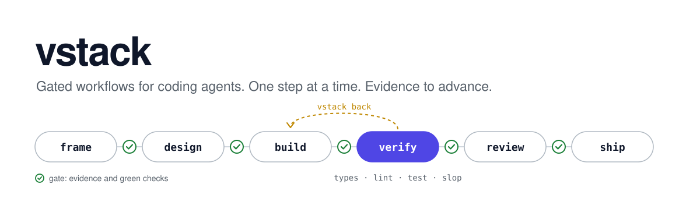
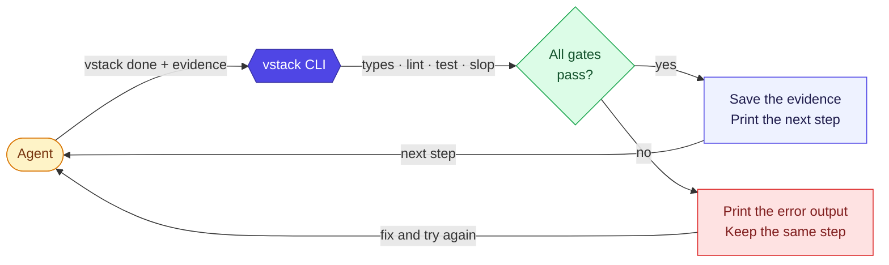
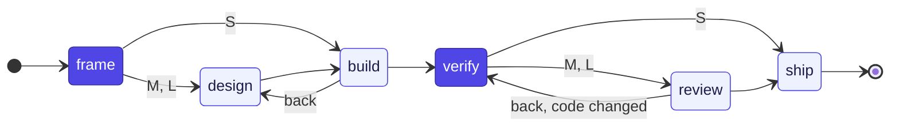
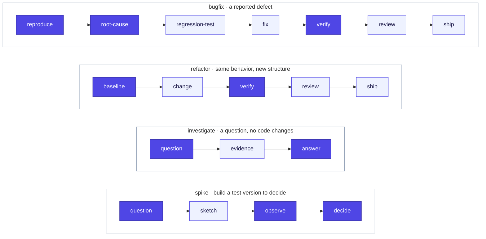
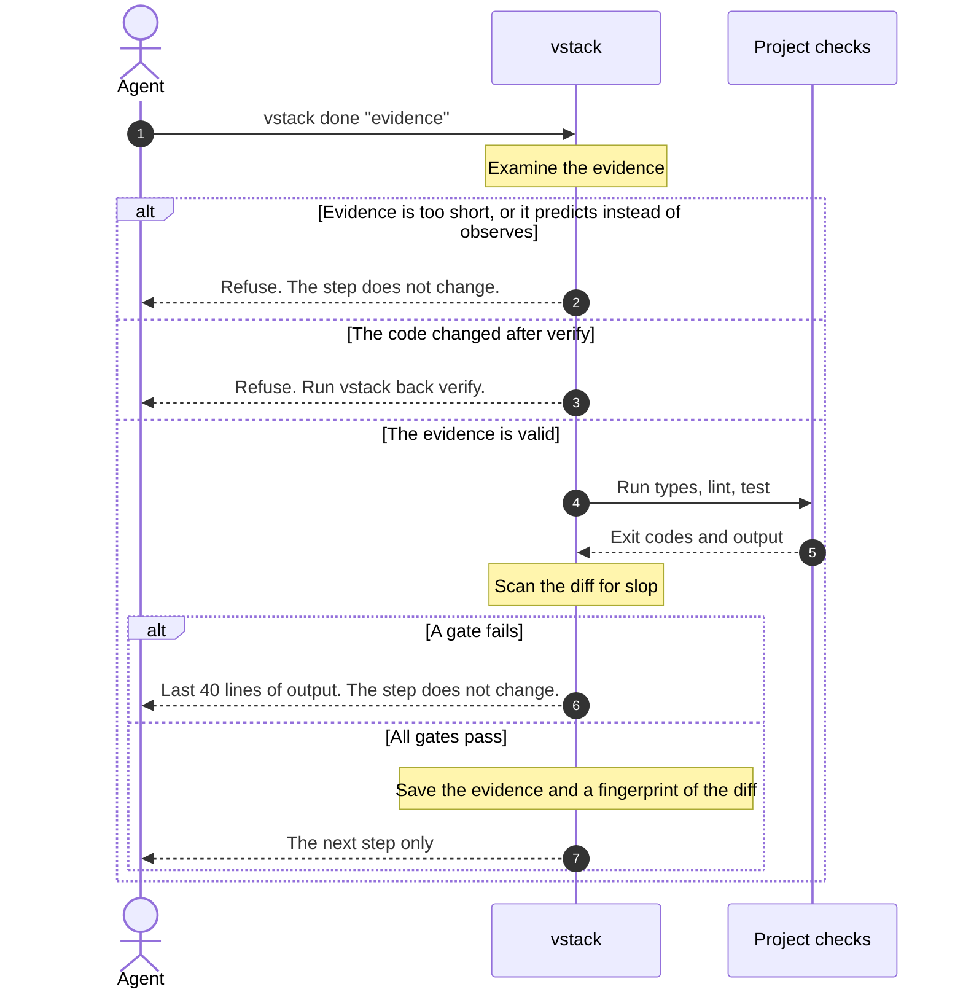
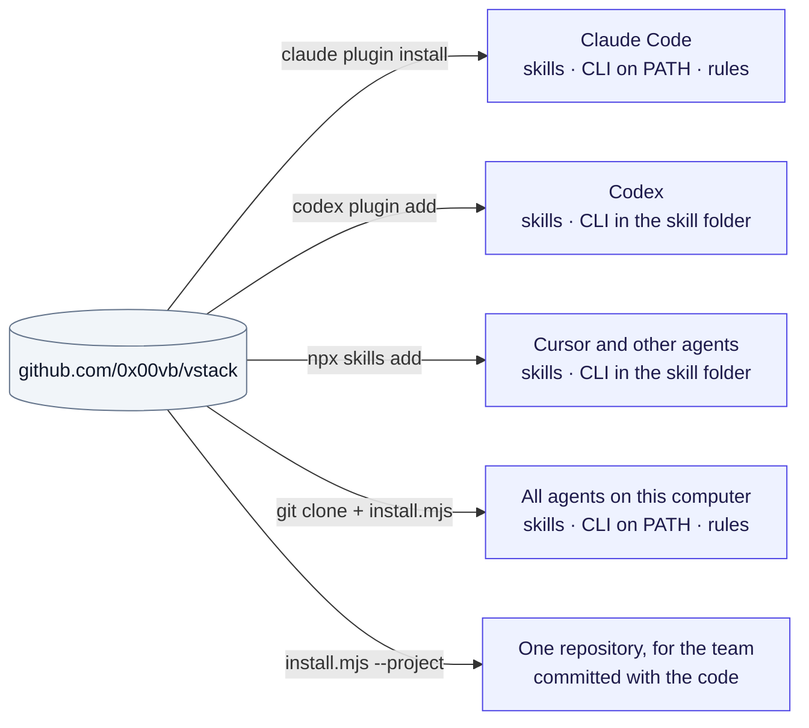
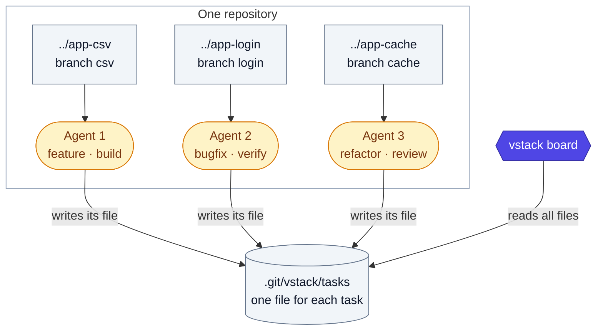
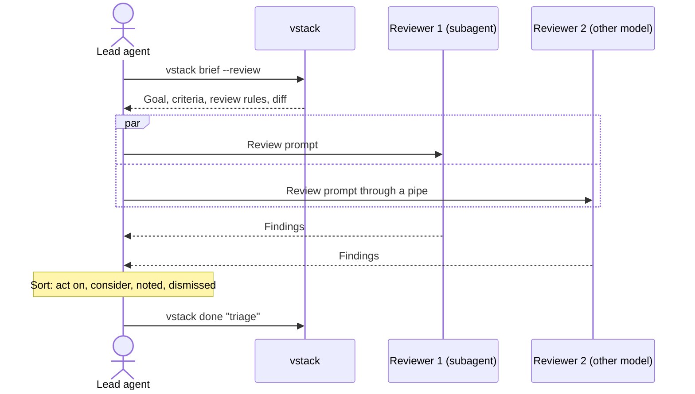

<p align="center">
  <picture>
    <source media="(prefers-color-scheme: dark)" srcset="assets/hero-dark.svg">
    
  </picture>
</p>

<p align="center">
  <b>vstack is a state machine for AI coding agents.</b><br>
  It gives the agent one step at a time.<br>
  The agent goes to the next step only when it gives evidence and the checks pass.
</p>

<p align="center">
  <a href="#install">Install</a> ·
  <a href="#how-it-works">How it works</a> ·
  <a href="#flows">Flows</a> ·
  <a href="#gates">Gates</a> ·
  <a href="#many-agents">Many agents</a> ·
  <a href="#configuration">Configuration</a>
</p>

<p align="center">
  Claude Code · Codex · Cursor · any agent that reads <a href="https://agentskills.io">Agent Skills</a>
</p>

---

## Why vstack

vstack is an alternative to [pstack](https://github.com/cursor/plugins/tree/main/pstack), which [Lauren Tan (@poteto)](https://x.com/poteto) made. The main ideas of vstack come from pstack: workflows as state machines, evidence before "done", and principles that keep code small. vstack is the version of these ideas that we use every day.

AI agents write code quickly. Without control, an agent often does these things:

- It says "done" before it runs the code.
- It adds code that the task does not need.
- It adds `any` casts, empty `catch` blocks, and comments that repeat the code.
- It forgets instructions when the context gets long.

Both tools solve these problems. They put the workflow in different places:

- pstack puts the workflow in skills. The agent reads the rules, the playbooks, and the principles.
- vstack puts the workflow in a small CLI. The agent reads only the current step. The CLI runs the checks, so the agent does not have to remember them.

| | pstack | vstack |
|---|---|---|
| Where the workflow is | Skills that the agent reads | A CLI that prints one step at a time |
| Scope | About 50 skills. Playbooks for PRs, CI, performance, many-agent programs, and design and review with many models. | 1 skill and 5 flows |
| Agents | Cursor plugin | Claude Code, Codex, Cursor, and other agents that read Agent Skills |
| Skill descriptions, always in context | 11,539 characters | 293 characters |
| Instructions for one feature task | About 86,800 characters | About 6,600 characters |

<sub>Method: pstack is the minimum set of files that its Feature playbook tells the lead agent to read. vstack is the rules, the skill file, the review file, and all output from the CLI during a complete size M feature task. More instructions also give more capability. The numbers show a different design, not a better one.</sub>

Use pstack if you work in Cursor and want the complete system. Use vstack if you want a small set of gates in any agent.

## Terms

This document uses these terms with one meaning only.

| Term | Meaning |
|---|---|
| **Task** | One unit of work, for example "add CSV export". A task has one flow and one size. |
| **Flow** | The sequence of steps for one type of work: `feature`, `bugfix`, `refactor`, `investigate`, or `spike`. |
| **Step** | One stage of a flow, for example `design` or `verify`. The CLI shows one step at a time. |
| **Evidence** | The text that the agent gives when it completes a step. It says what the agent did and what the agent saw. |
| **Check** | A command of your project: `test`, `types`, or `lint`. |
| **Gate** | A condition that must be true before the task goes to the next step. The checks and the slop scan are gates. |
| **Size** | `S`, `M`, or `L`. The size sets which steps the flow includes. |

## How it works



1. The agent starts a task with `vstack start`.
2. The CLI prints the first step. A step has three parts: what to do, the principles that apply, and the evidence to give.
3. The agent does the work.
4. The agent runs `vstack done "<evidence>"`.
5. The CLI examines the evidence and runs the gates of the step.
   - If a gate fails, the CLI prints the last lines of the error output. The task stays on the same step.
   - If all gates pass, the CLI saves the evidence and prints the next step.

The CLI saves each task as a JSON file in `.git/vstack/tasks/`. Git does not commit this directory. All worktrees of the repository use the same directory.

This is real output from a size `S` feature task. The agent wrote `any`, an empty `catch`, and a comment that repeats the code. The `verify` step stops it:

```console
$ vstack done "it should work now"
"verify" needs observed evidence, not predictions. Run it and say what you saw. Quote output or test names in backticks.

$ vstack done "ran \`curl -s localhost:3000/api/attendees.csv\` and saw 3 rows"
- not configured: types, lint (vstack.json "checks")
✓ test 0.1s
✗ slop: 2 fail, 1 warn, 5 added lines since cce02acf
  ✗ src/csv.ts:1 type-escape: type escape hatch. Model the type
      export function toCsv(rows: any[]) {
  ⚠ src/csv.ts:2 narrating-comment: comment narrates the code. Keep only a non-obvious why
      // Loop over the rows
  ✗ src/csv.ts:3 swallowed-error: error swallowed. Handle it or let it propagate
      try { return rows.map(r => r.name).join("\n") } catch (e) {}
  intentional? append "vstack-ok" to the line, or set slop.off / slop.ignore in vstack.json
gate failed, still on "verify". Fix and run vstack done again, or vstack back <step> "<why>".
```

## Flows

vstack has five flows. Each flow is a JSON file in [`skills/vstack/flows/`](skills/vstack/flows).

### Feature



The dark steps are mandatory. The agent cannot skip them. The agent can skip a light step only with a reason, for example `vstack skip "one-line config change"`.

| Step | What the agent does | Gates |
|---|---|---|
| `frame` | Writes the goal, who sees the change, the acceptance criteria, and what is out of scope. | Evidence |
| `design` | Reads only the code that the change touches: entry points, data shape, callers, and the nearest pattern. Then writes the caller's code first, then the types. Lists the code to delete. | Evidence |
| `build` | Makes the smallest change that meets the criteria. Commits each unit that passes. | Evidence |
| `verify` | Runs the feature on the real surface (endpoint, CLI, or page). Examines each criterion. | Observed evidence, types, lint, test, slop |
| `review` | Gets a review from a reviewer with no shared context. Sorts each finding. At size M, the CLI skips this step if the diff has fewer than 20 changed lines. | Code is the same as at `verify` |
| `ship` | Makes small, ordered commits. Writes the PR description. Pushes only with permission. | Code is the same as at `verify` |

### Other flows



| Flow | Use it for | Special rules |
|---|---|---|
| `bugfix` | A defect that a person reported. | The agent must reproduce the defect before it writes a fix. The regression test must fail before the fix. |
| `refactor` | A change to structure that keeps the behavior. | The checks must pass before the first change. At the end, the behavior must be the same as the baseline. |
| `investigate` | A question: how does X work, why is Y like this, which option is better. | The agent labels each claim as measured, inferred, or guess. The flow changes no code. |
| `spike` | A design question that a test version can answer. | The test version is temporary. The agent does not merge it. |

## Task sizes

The agent selects a size when it starts the task.

| Size | Use it for | Effect |
|---|---|---|
| `S` | One clear change in one or two files. | The flow skips `design`, `review`, and `regression-test`. Diff budget: 200 added lines. |
| `M` | Most work. This is the default. | The flow includes all steps. It skips `review` if the diff has fewer than 20 changed lines. Diff budget: 800 added lines. |
| `L` | A change across many modules, or a design that people disagree about. | The design step asks for two different designs. The review step asks for two reviewers on different models. |

A very small edit, for example a typo, does not need a task.

## Gates

### What `vstack done` does



| Condition | Result |
|---|---|
| The evidence has fewer than 12 characters. | The CLI refuses. |
| The step needs observed evidence, and the evidence contains a prediction such as "should", "probably", or "looks good". Text in quotes or backticks is not examined. | The CLI refuses. |
| The step needs verified code, and the diff changed after the last gate run. A rebase also changes the diff. | The CLI refuses and tells the agent to run `vstack back verify`. |
| A check fails. | The CLI prints the last 40 lines of output. The step does not change. |
| The slop scan finds a failure. | The CLI prints each finding with its file and line. The step does not change. |

The CLI prints one line for each check that passes. It prints the full error output only for a check that fails. This keeps the agent's context small.

### The slop scan

The slop scan examines the lines that the task added: commits, changes that are not committed, and new files that Git does not track. It examines code files only.

| Rule | Level | Example |
|---|---|---|
| `type-escape` | Fail. Warning in test files. | `x as any`, `: any`, `@ts-ignore` |
| `suppressed-check` | Fail | `eslint-disable`, `# noqa`, `# type: ignore` |
| `swallowed-error` | Fail | `catch (e) {}`, `except: pass`, `.catch(() => {})` |
| `debugger` | Fail | `debugger;`, `breakpoint()` |
| `debug-output` | Warning | `console.log(`, `print(` |
| `todo` | Warning | `TODO`, `FIXME`, `HACK` |
| `narrating-comment` | Warning | `// Update the counter`, `// Step 1` |
| `commented-code` | Warning | `// const x = load();` |
| Diff budget | Warning | More added lines than the size allows |

To keep a line on purpose, add `vstack-ok` and the reason to that line:

```ts
const legacy = payload as any; // vstack-ok: the vendor types are wrong, issue #412
```

## Install

You need Node.js 20 or later and Git.



Use one method only. If you use a plugin and the installer together, the agent loads the rules two times.

### Claude Code

1. Add the marketplace:
   ```bash
   claude plugin marketplace add 0x00vb/vstack
   ```
2. Install the plugin:
   ```bash
   claude plugin install vstack@vstack
   ```
3. Start a new session.

You can also do this in a session. Type `/plugin marketplace add 0x00vb/vstack`, then type `/plugin install vstack@vstack`.

The plugin adds the skills and puts `vstack` on the PATH. A hook loads the short rules when each session starts.

### Codex

1. Add the marketplace:
   ```bash
   codex plugin marketplace add 0x00vb/vstack
   ```
2. Install the plugin:
   ```bash
   codex plugin add vstack@vstack
   ```

The CLI is in the skill folder. The skill tells the agent to run `node <skill folder>/vstack.mjs` when `vstack` is not on the PATH.

### Cursor and other agents

1. Install the skills:
   ```bash
   npx skills add 0x00vb/vstack
   ```
2. Select the agents in the prompt.

This method also works for Claude Code and Codex.

### All agents on this computer

1. Clone the repository:
   ```bash
   git clone https://github.com/0x00vb/vstack ~/projects/vstack
   ```
2. Do a test run. This shows each file that the installer will change:
   ```bash
   node ~/projects/vstack/install.mjs --dry-run
   ```
3. Install:
   ```bash
   node ~/projects/vstack/install.mjs
   ```

The installer does these things:

- It links the skills into `~/.agents/skills/` (Codex and Cursor) and `~/.claude/skills/` (Claude Code).
- It links the CLI to `~/.local/bin/vstack`.
- It adds a marked block of rules to `~/.claude/CLAUDE.md` and `~/.codex/AGENTS.md`. It also adds the block to `~/.gemini/GEMINI.md` if that folder exists.

The installer does not overwrite a file that it did not create. To update, run `git pull`. To uninstall, run `node ~/projects/vstack/install.mjs --uninstall`.

Cursor has no global rules file. Copy [`rules/kernel.md`](rules/kernel.md) into **Cursor Settings > Rules**, or install into the repository.

### One repository, for the team

1. Go to the root of the repository.
2. Install:
   ```bash
   node ~/projects/vstack/install.mjs --project .
   ```
3. Commit `.agents/skills/`, `.claude/skills/`, `AGENTS.md`, and `CLAUDE.md`.

Each person on the team gets vstack from the repository. They need only Node.js. To uninstall, run the same command with `--uninstall`.

## Quick start

1. Go to your repository.
2. Write the check commands to `vstack.json`:
   ```bash
   vstack init
   ```
3. Read `vstack.json`. Change each command that is wrong or slow.
4. Give the task to your agent, for example: *"Use vstack. Add CSV export to the attendee list."*
5. Monitor the task:
   ```bash
   vstack board
   ```

The agent selects the flow and the size. Then it does each step that the CLI prints.

## Commands

| Command | What it does |
|---|---|
| `vstack start <flow> "<goal>" --size S\|M\|L` | Starts a task and prints the first step. |
| `vstack` | Prints the current step. |
| `vstack done "<evidence>"` | Runs the gates, saves the evidence, and prints the next step. |
| `vstack skip "<reason>"` | Skips a step that is not mandatory. |
| `vstack back <step> "<why>"` | Returns to an earlier step. |
| `vstack note "<decision> because <why>"` | Saves a decision in the task log. |
| `vstack check [gates]` | Runs the gates and does not change the step. |
| `vstack slop` | Runs only the slop scan. |
| `vstack brief` | Prints instructions for a subagent that has no other context. |
| `vstack brief --review` | Prints a review prompt with the goal, the criteria, and up to 40,000 characters of the diff and the new files. |
| `vstack board [--all]` | Shows all tasks in all worktrees of the repository. |
| `vstack log` | Shows each step, its evidence, and the notes of the task. |
| `vstack use <id>` | Selects a different task in this worktree. |
| `vstack abandon "<why>"` | Stops a task. |
| `vstack init` | Writes `vstack.json` with the detected checks. |
| `vstack flows` | Lists the flows. |

Use `--task <id>` or the `VSTACK_TASK` variable to select a task.

## Many agents

Give each agent its own worktree. Each agent runs its own task. One command shows all of them.



```console
$ git worktree add ../app-csv -b csv
$ vstack board
task                          flow      size  step        updated  branch  worktree
fix-login-redirect            bugfix    S     4/5 verify  0m       login   ../app-login
add-csv-export-attendee-list  feature   M     4/7 build   0m       csv     ../app-csv
split-cache-module            refactor  M     5/6 review  2h!      cache   ../app-cache
```

`2h!` means that the task did not change step for more than two hours. Examine that agent.

Follow these rules:

1. Use one task, one worktree, one branch, and one agent together.
2. Run tasks that change the same files one after the other, not at the same time.
3. Give each subagent a complete brief. A subagent cannot ask you questions. `vstack brief` gives the structure.
4. Review each branch with a different model than the model that wrote it.
5. Merge in order of dependency. After a rebase, the branch must pass `verify` again.

Run only as many agents as you can review.

## Cross-model review

Two models from different families find different problems. If both models find the same problem, it is probably real.



Send the review prompt to another agent CLI:

```bash
vstack brief --review | codex exec -
vstack brief --review | claude -p
vstack brief --review | cursor-agent -p
```

The prompt contains the diff and the content of new files. Thus the reviewer reads other code only to examine a possible problem. If the diff is larger than the limit, the prompt tells the reviewer to run `git diff`.

The lead agent puts each finding in one group:

| Group | Meaning |
|---|---|
| **Act on** | The finding stops a real PR: correctness, security, data loss, or maintenance cost. The agent fixes it. |
| **Consider** | The finding is valid, but the cost may be too high now. The user decides. |
| **Noted** | The finding is valid but needs no action. |
| **Dismissed** | The finding is wrong or misses context. The agent gives the reason. |

## Configuration

The CLI finds the checks automatically. To set them yourself, run `vstack init` and edit `vstack.json` at the root of the repository.

```json
{
	"base": "main",
	"checks": {
		"test": "pnpm --filter web test",
		"types": "pnpm --filter web exec tsc --noEmit",
		"lint": null
	},
	"slop": {
		"off": ["todo"],
		"ignore": ["**/generated/**"],
		"budget": { "S": 200, "M": 800 }
	},
	"minDiff": { "M": 20 }
}
```

| Field | Meaning |
|---|---|
| `base` | The branch to compare with when a task has no start commit. |
| `checks` | The command for each check. `null` disables a check. You can add more names and use them in a flow. |
| `slop.off` | Slop rules to disable. |
| `slop.ignore` | Files that the slop scan does not examine. |
| `slop.budget` | The maximum number of added lines for each size. |
| `minDiff` | For each size, the smallest diff (in changed lines) that gets a review. `{ "M": 0 }` gets a review for each diff. |
| `timeoutMs` | The time limit for each check. The default is 20 minutes. |

The CLI uses these files to find the checks:

| File | Checks |
|---|---|
| `package.json` | The `test`, `typecheck`, and `lint` scripts. It uses pnpm, yarn, bun, or npm from the lock file. It uses `tsc --noEmit` if `tsconfig.json` exists. |
| `go.mod` | `go test ./...` and `go vet ./...` |
| `Cargo.toml` | `cargo test` and `cargo clippy` |
| `pyproject.toml` | `pytest -q` |

In a monorepo, set each check to the package that you work on. The CLI runs the checks at each `verify` step.

## Change vstack

### Flows

A flow is a JSON file. To add a flow or replace a flow in one repository, put the file in `.vstack/flows/`.

```json
{
	"about": "Change a database schema.",
	"states": [
		{ "id": "plan", "must": true, "do": "Write the migration and its rollback.", "exit": "both SQL files" },
		{ "id": "verify", "must": true, "observed": true, "run": ["test", "migrate"], "do": "Run the migration on a copy of the data.", "exit": "row counts before and after" }
	]
}
```

| Field | Meaning |
|---|---|
| `id` | The name of the step. |
| `do` | The instruction that the agent gets. |
| `exit` | The evidence that the step needs. |
| `must` | The agent cannot skip the step. |
| `observed` | The CLI refuses evidence that predicts. |
| `run` | The gates: `test`, `types`, `lint`, `slop`, or a name from `checks`. |
| `sizes` | The sizes that include the step, for example `["M", "L"]`. |
| `verified` | The CLI refuses if the code changed after the last gate run. |
| `principles` | Tags. The CLI adds the principles with these tags to the step. |
| `minDiff` | For each size, the CLI skips the step if the diff has fewer changed lines. |

### Principles

The principles are in [`skills/vstack/principles.md`](skills/vstack/principles.md). Each principle is one line with tags:

```md
- **Subtract before adding** `build` - Delete dead and speculative code first, then build on the simpler base.
```

The CLI adds a principle to a step only when the step has a tag of that principle. Each principle appears one time in a task. The agent never reads the full list. `vstack` with no command shows all principles of the current step again.

When an agent makes the same mistake again and again, add a slop rule or a gate. Do not add more text.

## Repository layout

```text
skills/
  vstack/            The skill: SKILL.md, the CLI, flows, principles
    review.md        Review with no shared context, and the triage rules
    parallel.md      Rules for many agents at the same time
bin/vstack           Wrapper that the Claude Code plugin puts on the PATH
rules/kernel.md      The short rules that load in each session
hooks/hooks.json     Loads the rules when a Claude Code session starts
install.mjs          Installer for all agents or one repository
.claude-plugin/      Claude Code plugin and marketplace
.agents/plugins/     Codex marketplace
plugin.json          Agent Plugins manifest
test/                Tests for the CLI
```

## Development

```bash
npm test
```

The tests make temporary Git repositories and run the real CLI in them.

## Credits

vstack exists because of [pstack](https://github.com/cursor/plugins/tree/main/pstack) by [Lauren Tan (@poteto)](https://x.com/poteto). These parts of vstack come from pstack ideas: the flows, the principles, the subagent brief, the gates before "done", and the review triage. If you work in Cursor, try pstack.

vstack has the MIT license. See [LICENSE](LICENSE). The pstack license is in [NOTICE](NOTICE).
